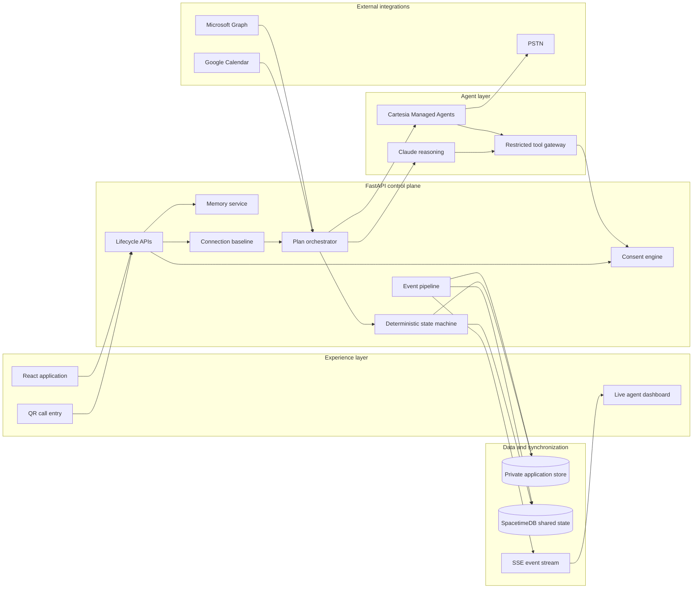

# Still Here

Still Here is a consent-aware coordination system that helps people maintain meaningful
relationships when initiating contact and organizing a plan feels difficult. It combines
voice agents, longitudinal relationship memory, calendar-aware scheduling, deterministic
workflow enforcement, and real-time shared state into one end-to-end system.

The core engineering principle is simple:

> Models interpret and propose. Deterministic services authorize and execute.

Claude can reason over approved context, Cartesia can conduct natural phone conversations,
and SpacetimeDB can synchronize a live multi-participant workflow. None of those components
can bypass consent, advance an illegal state transition, or confirm a plan without matching
participant approvals.

## System architecture



### Runtime components

| Layer | Technology | Responsibility |
|---|---|---|
| Web client | React 19, TypeScript 6, Vite 8, Tailwind CSS 4 | QR entry, trusted-circle flows, consent controls, companion UI, coordination visualization |
| API control plane | FastAPI, Pydantic, Uvicorn | Identity, lifecycle APIs, provider callbacks, authorization, validation, error contracts |
| Voice | Cartesia Managed Agents | Real outbound PSTN calls, call lifecycle events, webhook tool execution |
| Reasoning | Claude through the Anthropic API | Intent interpretation, preference extraction, grounded plan reasoning, constrained tool use |
| Shared coordination | SpacetimeDB 2.13 | Transactional proposal versions, participant responses, call state, consent projections, confirmation authority |
| Private persistence | SQLite in WAL mode | User records, phone data, private memory, OAuth grants, invitations, audit events, local read models |
| Live transport | Server-Sent Events | Ordered dashboard updates sourced from persisted backend events |
| Calendar adapters | Google Calendar API, Microsoft Graph | OAuth, free/busy synchronization, optional calendar event creation |

## End-to-end lifecycle

### 1. Call-first entry

`/call-now` invokes `POST /api/pitch/onboarding-call`. The backend resolves the configured,
verified phone identity and creates a call record before contacting the provider. Every call
stores two backend-owned fields:

- `purpose`: the verified lifecycle reason for the call;
- `authorized_context`: the exact identities, fields, actions, and plan information the agent
  may use.

The provider receives a deliberately narrow dynamic-variable projection. The agent never
chooses why it is calling and never receives unrestricted application memory.

### 2. Trusted-circle and consent graph

Onboarding and invitation APIs create explicit relationships between a patient and each
trusted contact. Outreach requires all of the following at execution time:

1. an active patient outreach preference;
2. an accepted relationship;
3. a verified destination number;
4. consent for the requested channel;
5. an allowed action within the consent scope;
6. compliance with quiet hours and frequency limits.

`services/consent.verify_outreach()` is the shared authorization gate. Voice initiation,
agent tools, scheduling, and group coordination all pass through the same policy surface.
Revocation is modeled as an interrupt and can halt any non-terminal plan state.

### 3. Longitudinal relationship memory

The memory subsystem stores structured facts with provenance instead of treating a transcript
as an unbounded prompt. Each memory contains:

- subject and relationship scope;
- semantic kind, normalized value, and confidence;
- source conversation and source quote;
- confirmation status;
- visibility classification;
- correction and tombstone history.

Audience-filtered retrieval is performed by `memory.shareable_context()`. Contact-facing
context is protected by both a visibility allow-list and an independent sensitive-content
guard. Planning can use approved relationship context without exposing private material to a
friend call or the public coordination store.

### 4. Connection-pattern detection

Timestamped `contact_events` are converted into a per-relationship baseline. The detector uses
observed intervals, recent gaps, confidence, suppression windows, and cooldowns to identify a
reconnection opportunity. It detects a change in interaction cadence; it does not infer a
diagnosis or a reason for that change.

The resulting opportunity contains structured evidence used by the planner:

- contact reference;
- baseline statistics and deviation ratio;
- supporting memory citations;
- suppression or cooldown state;
- a source-backed reason for the proposed connection.

### 5. Versioned plan creation

The orchestrator selects a contact, retrieves approved memories, checks availability, and
creates a versioned proposal. A proposal carries:

- activity and location;
- start time;
- `why_contact` and `why_activity` explanations;
- memory citations;
- superseded-version metadata;
- participant-specific responses against exact terms.

Counterproposals do not mutate an accepted agreement in place. They create a new proposal
version, invalidate approvals tied to the old terms, and return the workflow to coordination.

### 6. Sequential multi-person coordination

`services/group_coordination.py` advances through independently consented participants one
completed call at a time. A friend response is durably recorded before the next outbound call
can begin. Claude interprets conversational intent; backend code records the resulting response
against the current proposal version.

Typical constraints—unavailable days, end-time boundaries, activity changes, and optional
follow-on plans—become structured plan inputs rather than free-form transcript state.

### 7. Patient approval and confirmation

Friend acceptance only advances the workflow to `PATIENT_APPROVAL_PENDING`. The patient must
approve the exact activity and start time accepted by every participating contact.

Before confirmation, the backend:

1. re-reads all participant responses;
2. rejects stale proposal versions;
3. verifies that every response is `accepted`;
4. checks activity and time equality;
5. revalidates shared availability;
6. runs the SpacetimeDB `confirm_if_matching` reducer;
7. writes the private confirmation read model;
8. emits notifications idempotently.

No language model is given `confirm_plan`, `send_confirmation`, or `start_outbound_call` as an
executable tool.

## Deterministic workflow model

The plan lifecycle is an explicit state machine in
`backend/app/domain/state_machine.py`:

```text
OPPORTUNITY_IDENTIFIED
  → CONSENT_VERIFIED
  → MEMORY_RETRIEVED
  → CANDIDATE_PLAN_CREATED
  → CONTACT_IN_PROGRESS
  → FRIEND_ACCEPTED | FRIEND_DECLINED | FRIEND_COUNTERPROPOSED
  → PATIENT_APPROVAL_PENDING
  → PATIENT_ACCEPTED | PATIENT_DECLINED
  → AVAILABILITY_REVALIDATED
  → PLAN_CONFIRMED
  → NOTIFICATIONS_SENT
  → COMPLETE
```

Counterproposals loop through a new `CANDIDATE_PLAN_CREATED` version. Consent revocation can
transition any live state to `HALTED_CONSENT_REVOKED`. Any transition absent from the transition
table raises `TransitionError` and returns an HTTP `409 illegal_transition` envelope.

Group confirmation generalizes the two-party invariant: the patient and every invited contact
must accept identical terms. The group is intentionally bounded to keep coordination focused
and auditable.

## SpacetimeDB authority model

SpacetimeDB contains the sanitized shared coordination projection. Every shared mutation runs
through a reducer and therefore executes as one database transaction.

Core reducers include:

- `start_session`
- `set_consent_state`
- `set_call_state`
- `propose_or_revise_plan`
- `respond_as_friend`
- `record_patient_approval`
- `confirm_if_matching`
- `revoke_or_cancel`
- `append_sanitized_event`

SQLite maintains the private application record and efficient local read models. SpacetimeDB
stores only coordination-safe projections: redacted numbers, status values, proposal terms,
boolean consent state, participant responses, and sanitized event summaries.

The bridge uses stable proposal references of the form `<plan_id>_v<version>`. This prevents a
response to version 1 from being applied to version 2 and lets the confirmation reducer reject
stale, superseded, mismatched, revoked, or incomplete proposals with machine-readable reasons.

## Restricted agent tool surface

Claude and Cartesia share typed server-side tool handlers, keeping validation behavior identical
across chat and voice channels.

| Tool | Authority |
|---|---|
| `get_support_context` | Read consent-filtered, contact-safe context with citations |
| `verify_consent` | Read the current authorization decision for one action |
| `find_free_slots` | Read overlapping participant availability |
| `suggest_activity` | Produce a memory-grounded candidate with citations |
| `lookup_showtimes` | Retrieve illustrative activity options |
| `record_friend_response` | Record a response against current proposal terms |
| `request_patient_approval` | Move an eligible plan to the patient-approval gate |
| `store_preference_feedback` | Store a sourced preference or boundary |

Tool requests enter a single dispatcher. Unknown tools and backend-only operations are refused
before handler execution. Live conversational turns receive an even narrower subset: planning
state advancement remains owned by deterministic response processing.

## Calendar and scheduling subsystem

Google and Microsoft adapters implement the same provider-neutral contract:

- OAuth state validation;
- minimal free/busy scopes by default;
- explicit additional consent for calendar writes;
- sealed refresh-token storage with integrity verification when `CALENDAR_TOKEN_KEY` is configured;
- token refresh and revocation handling;
- time-zone normalization;
- busy-block merging and free-window derivation;
- idempotent event creation.

The planner consumes normalized `availability` rows, so manual availability and provider-backed
free/busy data use the same intersection and revalidation algorithm.

## Event and dashboard architecture

`services/events.emit()` is the single event creation path. It assigns a monotonic sequence,
redacts payloads, persists the audit row, mirrors the sanitized projection to SpacetimeDB, and
fans the event out to SSE subscribers.

The live dashboard is a projection of backend state rather than a client-side animation. It
visualizes:

- connection-baseline changes;
- retrieved memory citations;
- proposal versions and rationale;
- active call state;
- participant constraints and responses;
- scheduling overlap;
- reducer and tool execution;
- patient approval and final confirmation.

SSE reconnection uses ordered persisted events, allowing the UI to recover state after a browser
refresh without reconstructing the workflow locally.

## Security architecture

Still Here treats model output and provider callbacks as untrusted input.

- **Server-side authorization:** consent and state transitions are checked at execution time.
- **Verified call intent:** call purpose and authorized context originate in the backend and are
  persisted before dialing.
- **Webhook authentication:** Cartesia tool routes require the configured shared credential.
- **Least privilege:** models cannot dial, confirm, or notify directly.
- **Private/shared separation:** phone numbers, transcripts, OAuth tokens, and private memory stay
  outside SpacetimeDB's public coordination tables.
- **Redaction:** phone numbers, credentials, and sensitive payload fields are removed before event
  persistence and logging.
- **OAuth protection:** state tokens bind callbacks to the initiating user and requested scope.
- **Token protection:** production calendar credentials are sealed with `CALENDAR_TOKEN_KEY` and
  never returned by status APIs.
- **Idempotency:** outbound calls, confirmations, notifications, and calendar writes use stable
  idempotency keys.
- **Version binding:** approvals are valid only for the proposal version and exact terms shown to
  that participant.
- **Fail-closed confirmation:** an authoritative reducer rejection prevents the local confirmation
  write.

Secrets are loaded from environment variables. `.env`, database files, runtime logs, and generated
provider evidence are excluded from version control.

## API topology

| Route group | Responsibility |
|---|---|
| `/api/onboarding/*` | Identity verification, patient preferences, invitations, relationship activation |
| `/api/calendar/*` | OAuth, provider status, synchronization, disconnection |
| `/api/voice/tools/*` | Authenticated Cartesia webhook tools |
| `/api/voice/webhook` | Provider call-lifecycle ingestion |
| `/api/inbound/*` | Caller resolution and inbound-call authorization |
| `/api/events/stream` | Token-protected real-time event stream |
| `/api/pitch/*` | Controlled end-to-end coordination scenario |
| `/api/status` | Redacted runtime capability snapshot |
| `/health` | Process and private-store health |

The production frontend is served by FastAPI from `frontend/dist`, placing the SPA, API, QR
entry, provider callbacks, and dashboard on one origin.

## Execution profiles and observability

Provider selection is explicit and observable. `/api/status` reports independent modes for:

- voice execution;
- Claude conversation reasoning;
- SpacetimeDB coordination;
- calendar availability.

Adapters preserve the same domain contracts across local development and connected-provider
execution. Events retain the selected mode, provider call identifier, timing, proposal version,
and idempotency metadata, enabling deterministic debugging without logging credentials or raw
private context.

## Local development

### Prerequisites

- Python 3.11+
- Node.js 20+
- SpacetimeDB CLI 2.13+
- Cartesia and Anthropic credentials for connected voice/reasoning execution
- Google or Microsoft OAuth credentials for calendar connections

### Install

```bash
python -m venv .venv
./.venv/Scripts/python.exe -m pip install -r backend/requirements.txt
cd frontend && npm install && cd ..
cp .env.example .env
```

### Start the stack

```bash
make stdb-server   # SpacetimeDB local server
make stdb          # publish the Still Here module
make backend       # FastAPI on :8000
make frontend      # Vite development server on :5173
```

Or launch the coordinated demo stack:

```bash
make demo-up
```

Key routes:

- `http://localhost:8000/pitch-demo` — call entry and live agent visualization
- `http://localhost:8000/call-now` — one-scan call trigger
- `http://localhost:8000/dashboard` — operational event dashboard
- `http://localhost:8000/docs` — generated OpenAPI interface

### Provider configuration

Copy `.env.example` to `.env` and configure the required provider identifiers. Important groups:

```text
CARTESIA_API_KEY
CARTESIA_AGENT_ID
CARTESIA_FROM_NUMBER_ID
MY_PHONE_E164

ANTHROPIC_API_KEY
ANTHROPIC_MODEL

SPACETIMEDB_HOST
SPACETIMEDB_DB
SPACETIMEDB_TOKEN

GOOGLE_CLIENT_ID / GOOGLE_CLIENT_SECRET
MICROSOFT_CLIENT_ID / MICROSOFT_CLIENT_SECRET
CALENDAR_TOKEN_KEY

PUBLIC_BASE_URL
WEBHOOK_SECRET
DASHBOARD_TOKEN
```

Run provider discovery without placing a call:

```bash
make preflight
make arm
```

## Verification

```bash
make test          # unit and integration suite
make e2e           # complete lifecycle contract
make chaos         # failure and recovery behavior
make verify        # all acceptance gates

cd frontend
npm run build      # TypeScript + production Vite build
npm run lint
```

The suite covers consent revocation, quiet hours, rate limits, memory visibility, content
filtering, stale proposal versions, mismatched approvals, counterproposals, idempotency,
calendar token handling, reducer rejection, call lifecycle ordering, and private-context leakage.

## Repository map

```text
backend/app/
  api/              FastAPI route groups and provider callbacks
  agents/           Claude conversation loop and restricted tool dispatcher
  adapters/         Cartesia, Anthropic, SpacetimeDB, Google, Microsoft
  services/         consent, memory, baseline, planning, voice, events
  domain/           deterministic state machine and confirmation invariants
  db.py             private SQLite schema and migrations

backend/tests/       unit, integration, security, adapter, and state tests
frontend/src/       React pages, components, API client, event hooks
spacetime/           SpacetimeDB module, tables, reducers, subscriptions
scripts/             setup, preflight, orchestration, smoke, and verification tools
specs/               frozen API, tool, state, and cross-store contracts
docs/                architecture, security, privacy, operations, and runbooks
```

## Product boundary

Still Here is a voluntary social-connection system. It is not a diagnostic model, clinical
monitoring service, treatment system, or emergency-response service. The architecture detects
changes in consented interaction records and coordinates social plans; it does not infer mental
state or replace professional care.
